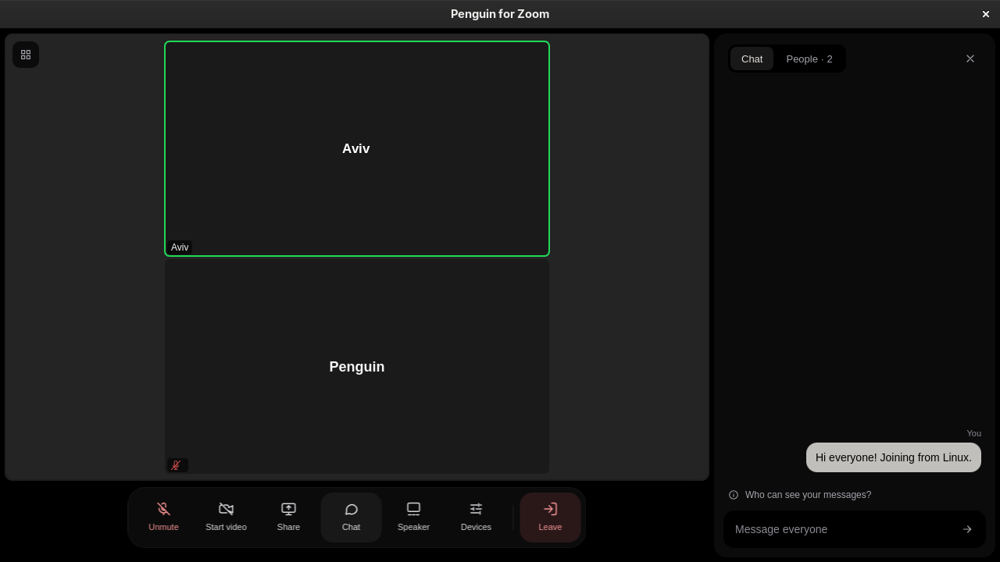

<div align="center">

# Penguin for Zoom

**Zoom meetings in a light Linux window.**



Click a Zoom link and it opens in a small native window.<br>
It opens fullscreen, and <b>F11</b> makes it a normal window,<br>
and you mute, share and leave from the keyboard.

No Electron and no bundled browser: Zoom's own web SDK, in the system WebKitGTK.

**Not released yet.** It is waiting for Zoom's app review,<br>
and until then it only joins meetings with the developer's own Zoom account.

## Install with an agent

Paste this into your AI coding agent (Claude Code, Codex, Cursor…):

```text
Install Penguin for Zoom on this Arch Linux machine by following
https://raw.githubusercontent.com/vaknin/penguin-zoom/master/AGENT-INSTALL.md
Ask me before any command that needs sudo.
```

Works on Arch and Arch-based distros (Omarchy, Manjaro, EndeavourOS).<br>
Prefer doing it yourself? The same steps are in [AGENT-INSTALL.md](AGENT-INSTALL.md).

## How it works

Click a Zoom meeting link, or paste one into the window with **Ctrl V**.<br>
Signed in, press **New meeting** (or **n**) to start your own and copy its invite link.<br>
Check your camera and microphone, then press **Join**.<br>
In the meeting, **m** mutes, **v** is the camera, **s** shares your screen.

<sub>An independent app, not made, endorsed or supported by Zoom Communications, Inc.<br>
Zoom is a trademark of Zoom Communications, Inc.</sub>

</div>
